# Praktikum 6 — JavaScript DOM dan Event Handling
Nama    :Raihan Nabil Mas'ud
NIM     :312510094
## Tujuan Praktikum

1. Memahami penggunaan DOM (Document Object Model) pada JavaScript.
2. Memilih dan mengubah elemen HTML menggunakan JavaScript.
3. Menggunakan event listener untuk menangani interaksi pengguna.
4. Mengubah gaya CSS menggunakan JavaScript.
5. Membuat penghitung karakter dan validasi formulir.
6. Membuat fitur interaktif sederhana melalui mini project.
7. Mendokumentasikan hasil latihan dan eksperimen mandiri.

## Struktur Folder

```text
Lab6Web/
├── index.html
├── style.css
├── script.js
├── README.md
└── Mini Proyek/
    ├── index-mini-project.html
    ├── script-mini-project.js
    ├── style-mini-poject.css
└── screenshot/
    ├── latihan1.png
    ├── latihan2.1.png
    ├── latihan2.png
    ├── latihan3.1.png
    ├── latihan3.2.png
    ├── latihan4.1.png
    ├── latihan4.2.png
    ├── latihan4.3.png
    ├── latihan5.1.png
    ├── latihan5.2.png
    ├── latihan5.3.png
    ├── latihan5.4.png
    ├── latihan5.5.png
    ├── latihan6.1.png
    ├── latihan6.2.png
    ├── mini-project.png
    ├── mini-project-valid.png
    ├── mini-project-invalid.png
    ├── eksperimen1.1.png
    ├── eksperimen1.2.png
    ├── eksperimen2.png
    ├── eksperimen3.png
    ├── eksperimen4.1.png
    ├── eksperimen4.2.png
    └── eksperimen5.png
```

**Keterangan file:**
- `index.html`: Struktur halaman web.
- `style.css`: Pengaturan tampilan halaman web.
- `script.js`: Kode JavaScript untuk manipulasi DOM, event handling, dan validasi.
- `README.md`: Dokumentasi kegiatan praktikum.
- `Mini Proyek/`: Tempat menyimpan Struktur dari Mini Project.
- `screenshot/`: Tempat menyimpan bukti hasil pengerjaan.

Nama file dan struktur di atas dapat disesuaikan dengan proyek yang benar-benar digunakan.

---

## Latihan 1 — Mengubah Teks dengan DOM

### Tujuan
Memahami cara memilih elemen HTML berdasarkan ID dan mengubah kontennya menggunakan JavaScript.

### Langkah Kerja
1. Membuat elemen judul dan paragraf pada HTML.
2. Memilih elemen menggunakan `document.getElementById()`.
3. Mengubah teks menggunakan properti `textContent`.
4. Menjalankan halaman melalui browser.
5. Memastikan teks pada halaman berubah sesuai kode JavaScript.

### Hasil
JavaScript berhasil mengubah judul dan isi paragraf pada halaman web.

### Screenshot
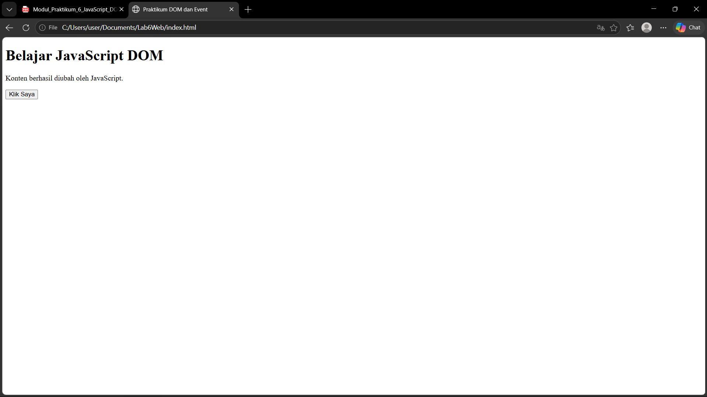

---

## Latihan 2 — Event Click

### Tujuan
Memahami penggunaan event `click` untuk menjalankan fungsi ketika pengguna menekan tombol.

### Langkah Kerja
1. Membuat tombol dan paragraf pada HTML.
2. Memilih tombol dan paragraf menggunakan JavaScript.
3. Menggunakan `addEventListener()` dengan event `click`.
4. Mengubah isi paragraf ketika tombol ditekan.
5. Menampilkan waktu saat tombol diklik menggunakan `new Date().toLocaleTimeString()`.

### Hasil
Teks pada halaman diperbarui setiap kali tombol ditekan.

### Screenshot
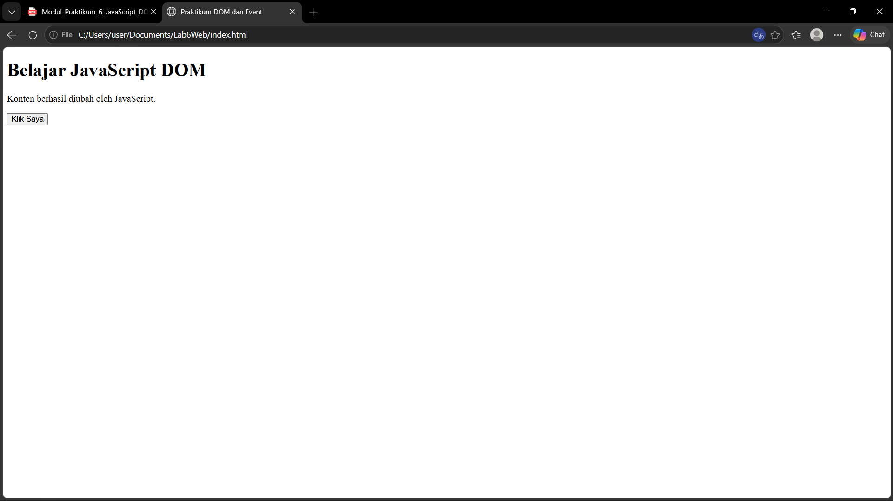


---

## Latihan 3 — Mengubah Kelas dan Gaya CSS

### Tujuan
Memahami cara JavaScript mengubah tampilan elemen HTML menggunakan kelas CSS.

### Langkah Kerja
1. Membuat paragraf dan tombol pada HTML.
2. Menambahkan kelas CSS `highlight` dan `teks-besar`.
3. Memilih elemen menggunakan `getElementById()`.
4. Menggunakan `classList.toggle()` ketika tombol diklik.
5. Mengamati perubahan warna, latar belakang, garis tepi, dan ukuran teks.

### Hasil
Tampilan paragraf dapat diubah melalui tombol dengan menambahkan atau menghapus kelas CSS.

### Screenshot
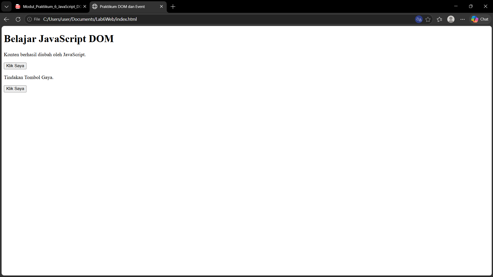
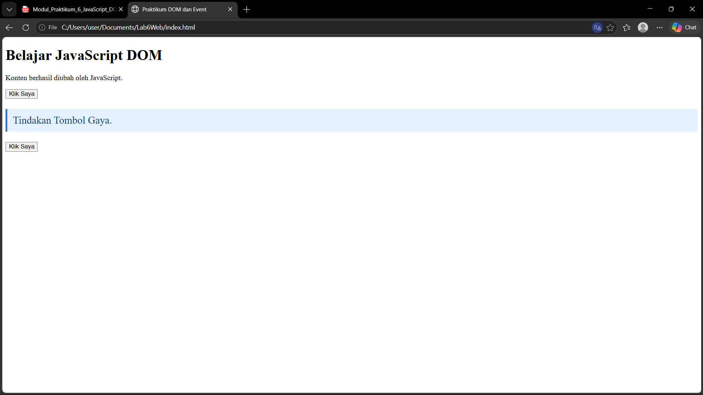

---

## Latihan 4 — Event Input dan Penghitung Karakter

### Tujuan
Memahami penggunaan event `input` untuk memperbarui informasi secara langsung ketika pengguna mengetik.

### Langkah Kerja
1. Membuat input teks dengan ID `namaInput`.
2. Membuat indikator jumlah karakter dengan ID `jumlahKarakter`.
3. Menambahkan event listener `input`.
4. Menghitung karakter menggunakan properti `length`.
5. Menguji dengan mengetik, menghapus, dan menempelkan teks.

### Hasil
Jumlah karakter diperbarui secara langsung mengikuti isi input.

### Screenshot
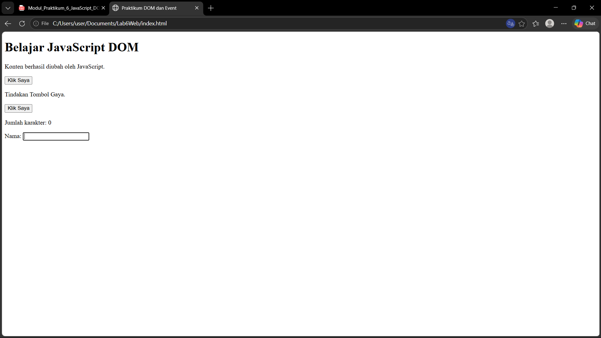

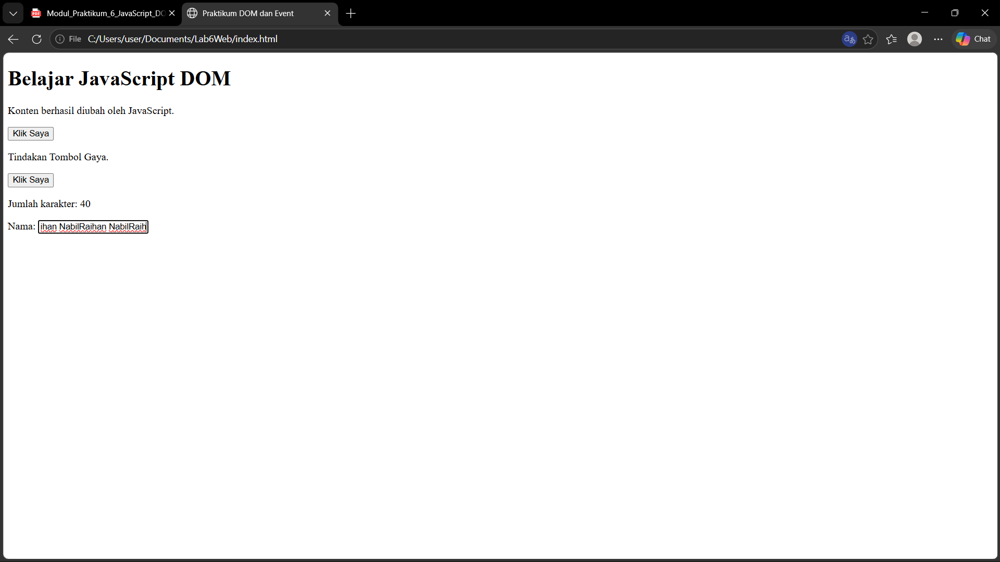

---

## Latihan 5 — Validasi Form Pendaftaran

### Tujuan
Menerapkan validasi formulir menggunakan JavaScript untuk memastikan data yang dimasukkan memenuhi ketentuan.

### Langkah Kerja
1. Membuat form yang berisi nama, email, dan usia.
2. Mengambil nilai input dari setiap elemen HTML.
3. Menggunakan `event.preventDefault()` agar form tidak langsung dikirim.
4. Memeriksa nama, format email, dan usia.
5. Menampilkan pesan kesalahan jika input tidak sesuai.
6. Menampilkan pesan keberhasilan jika seluruh input valid.

### Ketentuan Validasi
- Nama wajib diisi.
- Email harus memiliki format yang valid.
- Usia harus berupa bilangan bulat antara 17 sampai 100.

### Hasil
Form menampilkan pesan sesuai dengan kondisi input yang diberikan.

### Semua Kosong


### Nama Kosong
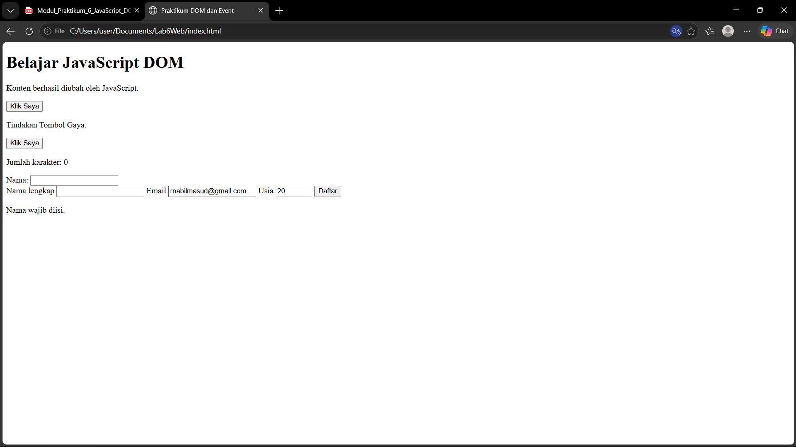

### Email Invalid


### Usia < 17
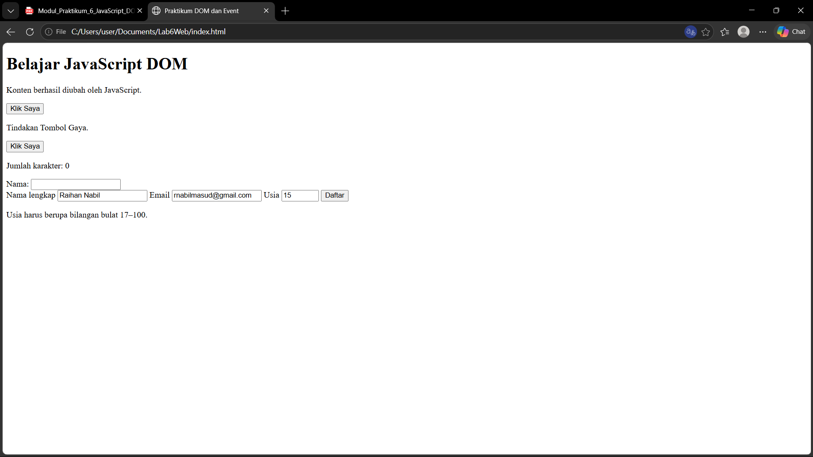

### Input Valid
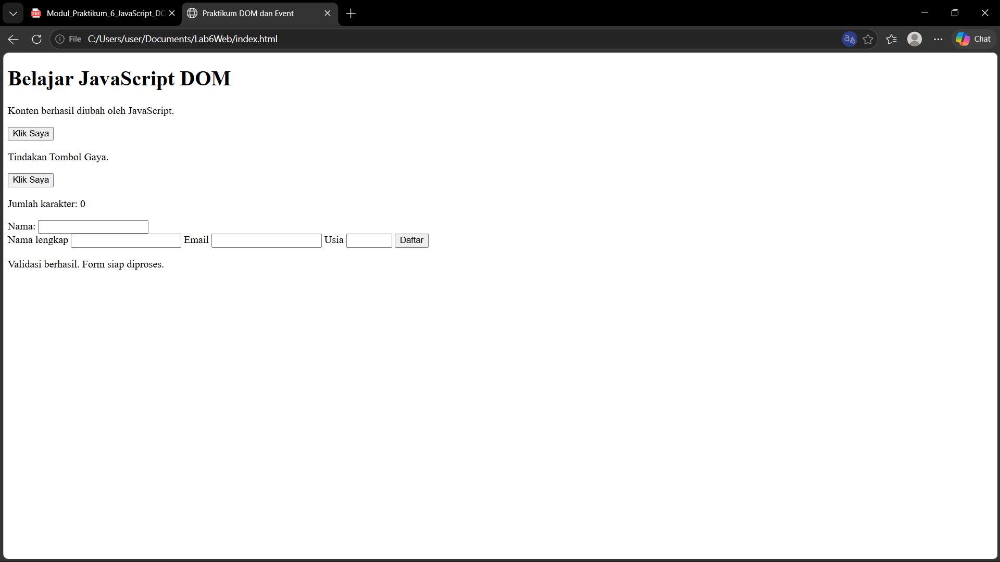

---

## Latihan 6 — To-do List

### Tujuan
Membuat daftar tugas sederhana menggunakan JavaScript untuk memahami manipulasi elemen DOM secara interaktif.

### Langkah Kerja
1. Membuat input untuk memasukkan tugas.
2. Membuat tombol untuk menambahkan tugas.
3. Menampilkan tugas yang dimasukkan ke dalam daftar.
4. Menggunakan JavaScript untuk membuat dan menambahkan elemen HTML.
5. Menguji fitur penambahan tugas sesuai kode yang dibuat.

### Hasil
Daftar tugas dapat ditampilkan pada halaman web melalui interaksi pengguna.

### Belum Selesai
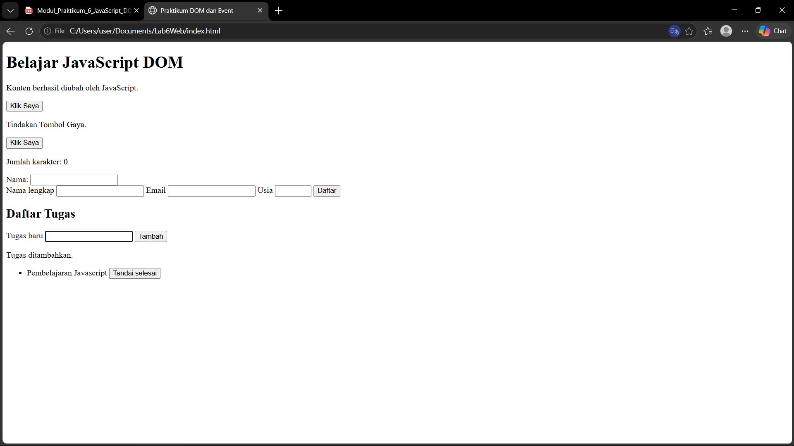

### Sudah Selesai


---

## Mini Project — Form Pendaftaran Workshop

### Tujuan
Menggabungkan konsep DOM, event handling, dan validasi input dalam sebuah halaman pendaftaran workshop yang interaktif.

### Fitur
1. Form pendaftaran peserta workshop.
2. Validasi nama, email, dan pilihan sesi.
3. Penghitung karakter atau ringkasan input secara langsung.
4. Pesan kesalahan dan pesan keberhasilan.
5. Tombol reset untuk mengosongkan input.
6. Penggunaan `addEventListener()` untuk menangani interaksi pengguna.
7. Tampilan yang menyesuaikan ukuran layar desktop maupun perangkat mobile.

### Langkah Kerja
1. Membuat struktur form pada `index.html`.
2. Mengatur tampilan form melalui `style.css`.
3. Menambahkan fungsi JavaScript pada `script.js`.
4. Menguji input yang tidak valid dan input yang valid.
5. Memastikan penghitung karakter atau ringkasan sesi bekerja.
6. Memastikan tombol reset dapat mengosongkan form.

### Hasil
Halaman pendaftaran workshop dapat menerima input pengguna, memeriksa data, menampilkan pesan, dan memberikan interaksi sesuai fitur yang dibuat.

### Screenshot Tampilan Mini Project
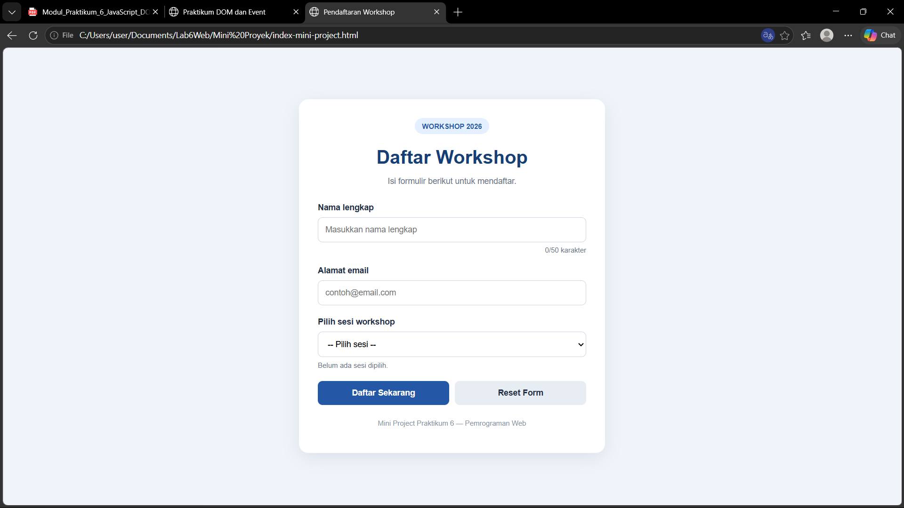

### Screenshot Pengujian Form Tidak Valid
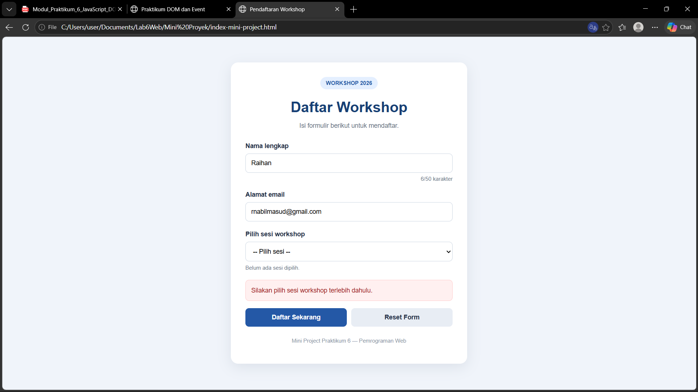

### Screenshot Pengujian Form Valid
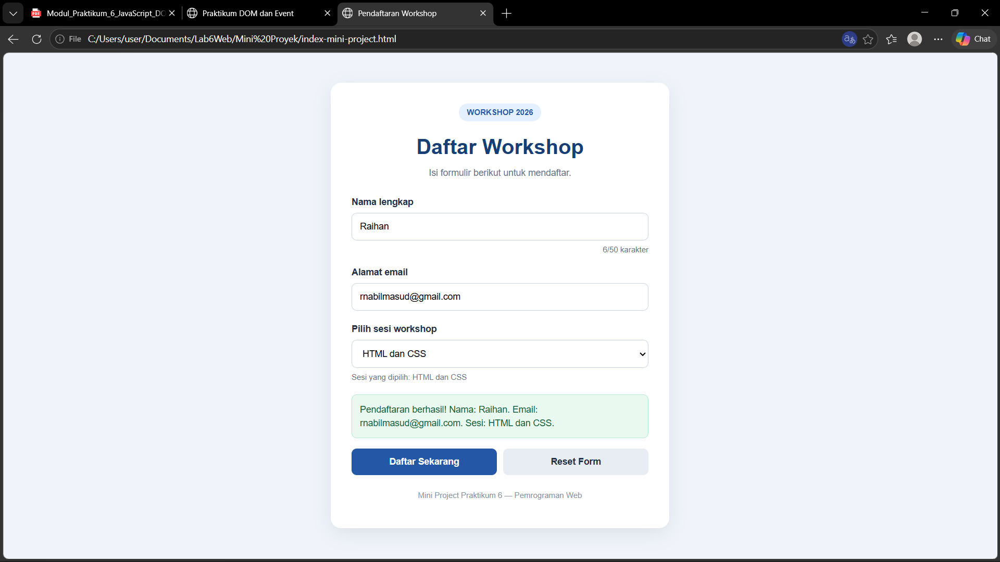

---

## Eksperimen Mandiri

### Eksperimen 1 — Menghapus Item To-do List

**Tujuan:** Menambahkan tombol untuk menghapus satu item dari daftar tugas.

**Langkah Kerja:**
1. Menambahkan tombol hapus pada setiap item tugas.
2. Menggunakan event `click` pada tombol hapus.
3. Menghapus item yang dipilih menggunakan manipulasi DOM.
4. Menguji penghapusan pada satu atau beberapa tugas.

**Hasil:** Item tugas dapat dihapus satu per satu melalui tombol yang tersedia.

**Screenshot:**

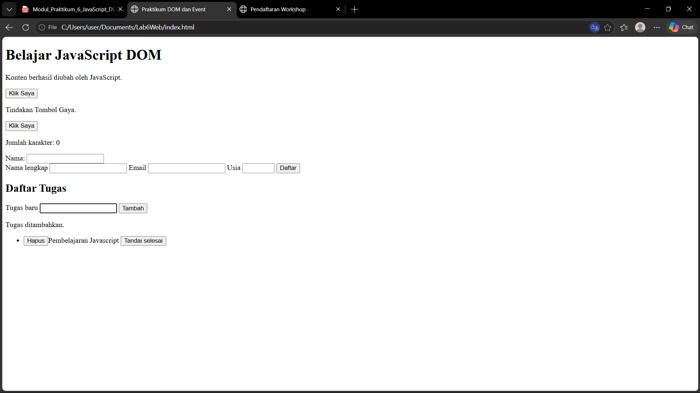

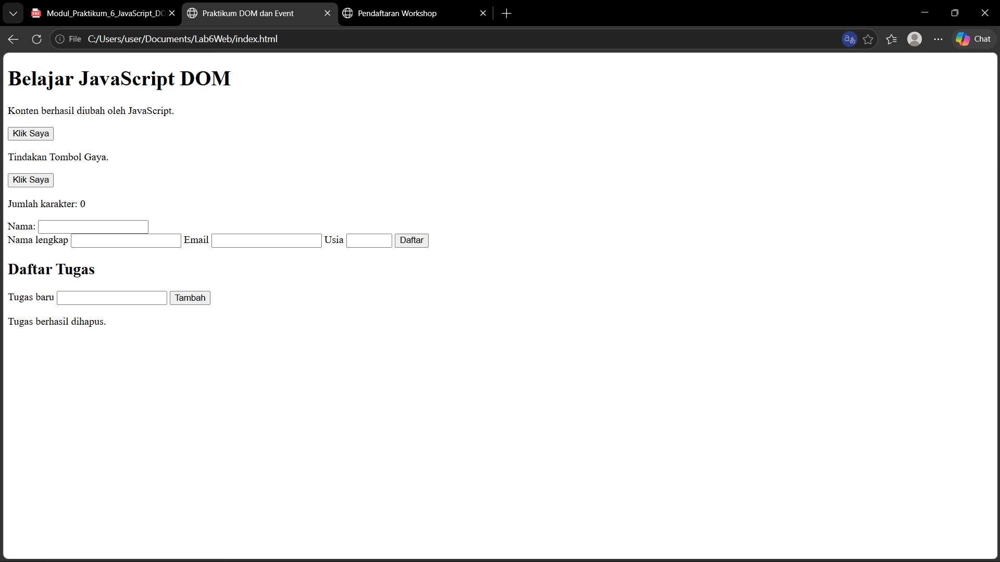

### Eksperimen 2 — Validasi Nama Minimal Tiga Karakter

**Tujuan:** Mengubah validasi nama agar peserta memasukkan nama dengan panjang minimal tiga karakter.

**Langkah Kerja:**
1. Mengambil nilai nama dari input.
2. Menghapus spasi di awal dan akhir menggunakan `trim()`.
3. Memeriksa jumlah karakter menggunakan `length`.
4. Menampilkan pesan kesalahan jika nama kurang dari tiga karakter.
5. Memastikan validasi email dan usia tetap berjalan jika nama memenuhi ketentuan.

**Hasil:** Nama kosong atau kurang dari tiga karakter ditolak oleh validasi.

**Screenshot:**

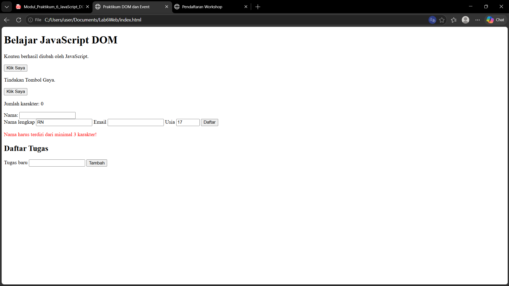

### Eksperimen 3 — Event Change pada Dropdown Sesi Workshop

**Tujuan:** Menampilkan sesi workshop yang dipilih oleh pengguna.

**Langkah Kerja:**
1. Membuat dropdown pilihan sesi workshop.
2. Menambahkan event listener `change`.
3. Mengambil nilai sesi yang dipilih.
4. Menampilkan informasi sesi pada halaman.
5. Menguji dengan memilih beberapa sesi yang berbeda.

**Hasil:** Informasi sesi diperbarui ketika pengguna mengubah pilihan dropdown.

**Screenshot:**

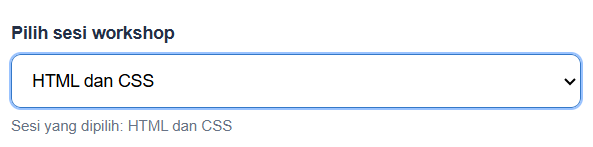

### Eksperimen 4 — Menyembunyikan dan Menampilkan Paragraf

**Tujuan:** Mengubah visibilitas paragraf menggunakan kelas CSS dan JavaScript.

**Langkah Kerja:**
1. Membuat paragraf dan tombol pada HTML.
2. Membuat kelas CSS yang menyembunyikan elemen.
3. Menambahkan event listener `click`.
4. Menggunakan `classList.toggle()` untuk mengubah visibilitas paragraf.
5. Menguji tombol untuk menyembunyikan dan menampilkan paragraf.

**Hasil:** Paragraf dapat disembunyikan dan ditampilkan kembali melalui tombol.

**Screenshot:**

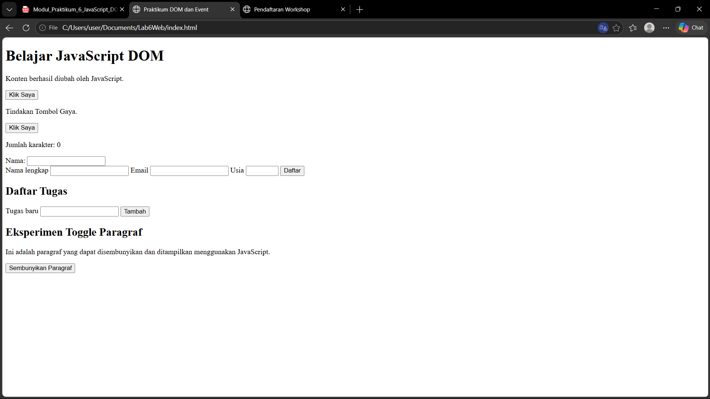

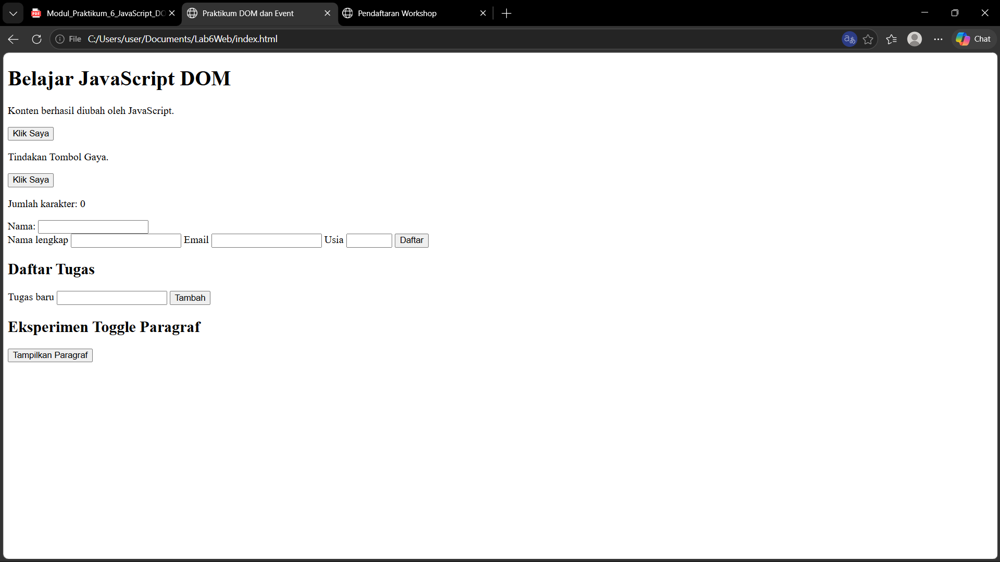

### Eksperimen 5 — Memindahkan Script ke Bagian Head

**Tujuan:** Memahami pengaruh posisi pemanggilan JavaScript terhadap akses elemen HTML.

**Langkah Kerja:**
1. Memindahkan tag pemanggil `script.js` ke dalam bagian `<head>`.
2. Menguji pemanggilan script tanpa atribut `defer`.
3. Mengamati apakah JavaScript dapat menemukan elemen HTML.
4. Memeriksa pesan kesalahan pada Console jika terjadi masalah.
5. Mengembalikan script ke posisi yang sesuai atau menggunakan atribut `defer`.

**Hasil dan Pengamatan:**

Jika script dijalankan sebelum elemen HTML selesai dibaca oleh browser, pemanggilan `document.getElementById()` dapat menghasilkan `null`. Hal tersebut dapat menyebabkan kesalahan ketika JavaScript mencoba memasang event listener pada elemen yang belum tersedia, dan apabila defer dihilangkan, maka script tidak akann berjalan.

**Screenshot:**

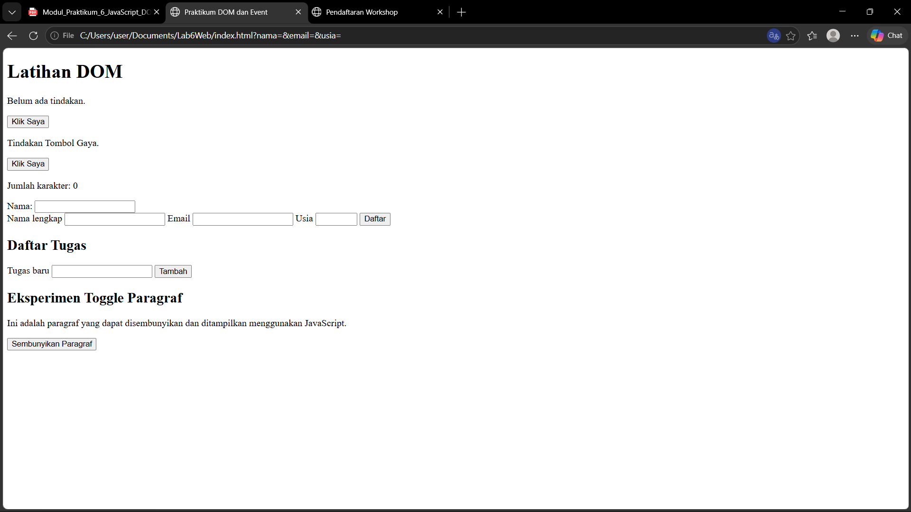

---